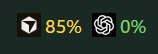
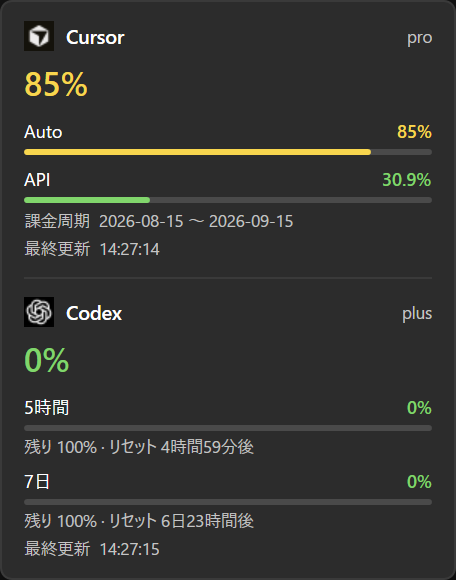

# AI Usage Bar

[English](README.md) | 日本語

Windows 11 のタスクバー通知領域の左隣に、AI コーディングツールの使用量を常時表示します。Cursor / Codex / Claude / OpenCode Go / Command Code に対応し、設定で表示するものを選べます。



タスクバーにはアイコンと使用率だけを出します。左クリックで内訳・リセット・課金周期などの詳細、右クリックから更新・設定・終了ができます。



## インストール

[Releases](https://github.com/ham0806/ai-usage-bar/releases) から `AI-Usage-Bar-win-x64.zip` をダウンロードし、展開して `AI Usage Bar.exe` を実行します。

表示言語は Windows の表示言語（英語 / 日本語）に合わせます。設定から上書きできます。

## 必要環境

- Windows 11
- .NET 8 SDK（開発時。`mise install dotnet@8`）
- Codex を見る場合は、普段使っている `codex login` 済みの環境
- Cursor を見る場合は、Cursor にログイン済みか、後述のセッショントークン
- Claude を見る場合は、Claude Code にログイン済み（`~/.claude/.credentials.json`）
- OpenCode Go / Command Code を見る場合は、それぞれのログイン、または設定に貼る API キー

## 起動

リポジトリで次を実行します。

```powershell
.\run.ps1
```

ログを見たいときや、ビルド済み exe がまだ無いときは次です。

```powershell
dotnet run --project src\AiUsageBar\AiUsageBar.csproj
```

すでに起動している場合は、二重起動せずに終了します。終了はウィジェットを右クリックして「終了」です。

Windows 起動時に始める場合は、ウィジェットの右クリックから設定を開き、「Windows 起動時に開始」をオンにします。

## exe で起動する

.NET を入れていない PC でも、`build.ps1` で作った exe をダブルクリックして起動できます。

```powershell
.\build.ps1
```

出力は `dist\AI Usage Bar\AI Usage Bar.exe` です。

exe から起動しているときは、「Windows 起動時に開始」もその exe を登録します。

`vX.Y.Z` タグを push すると GitHub Actions が zip 作成を行い、GitHub Release に添付します。

## Cursor の認証

優先して `%APPDATA%\Cursor\User\globalStorage\state.vscdb` の `cursorAuth/accessToken` を使います。取れないとき、または 401 になったときは設定に貼ったトークンを使います。トークンは Windows の資格情報マネージャーへ保存します。

貼り付ける値は cursor.com にログインしたブラウザの Cookie `WorkosCursorSessionToken` です。Chrome の開発者ツールで Application → Cookies → `https://cursor.com` からコピーできます。

この Cursor 側の取得は公式 API ではなく、ダッシュボードと同じ非公式エンドポイント `GET https://cursor.com/api/usage-summary` です。仕様変更やセッション期限切れで止まることがあります。

## Codex の認証

`%USERPROFILE%\.codex\auth.json`（または環境変数 `CODEX_HOME`）の ChatGPT OAuth を使い、期限が近いときは公式 CLI と同じ JSON でトークンを更新して `auth.json` に書き戻します。呼び出し先は `https://chatgpt.com/backend-api/codex/usage` と `https://chatgpt.com/backend-api/wham/usage` です。まだ失敗するときはインストール済みの `codex app-server` に JSON-RPC で `account/rateLimits/read` を投げます。設定の「codex login を開く」からもログインできます。トークンの中身はログに書きません。

## Claude の認証

`%USERPROFILE%\.claude\.credentials.json`（または環境変数 `CLAUDE_CONFIG_DIR`）の `claudeAiOauth` を使い、`GET https://api.anthropic.com/api/oauth/usage` から 5時間・7日・Opus の枠を読みます。有効期限が近いときは Claude Code と同じクライアント ID でトークンを更新し、`expiresAt` ごと書き戻します。Claude Code を別の場所でログインしている場合は、設定に OAuth トークンを貼ってください（資格情報マネージャーに保存します）。

## OpenCode Go の認証

使用量は console の API（`GET https://opencode.ai/console/api/usage/summary`）から取ります。この API は console のログインセッションでしか読めず、`~/.local/share/opencode/auth.json` の API キーでは 403 になります。

設定の「opencode にサインイン」を押すと、CLI と同じ device 認証（`/console/auth/device/code`）で console のセッションを取得して資格情報マネージャーに保存します。うまくいかないときは、console のセッション Cookie を設定に貼ってください（DevTools → Network → `usage/summary` → Request Headers → `Cookie`）。

表示は console の Limits パネルと同じです。`GET /console/api/go/status` の `access.meters`（`fiveHour` / `week` / `month`）から Rolling / Weekly / Monthly の使用率とリセット時刻を出します。バーは 5時間（Rolling）の使用率で、フライアウトに 3 つの枠を並べます。使用率は小数を切り上げて整数で表示します。リクエスト数・トークン・コスト・日別履歴は取得も表示もしません。

これらの API は console で選んでいるワークスペース単位で、`x-org-id` が必要です。ワークスペースは device 認証の `org_id`、トークン、または `GET /console/api/user/workspaces` から決めます。複数のワークスペースがあるときは、設定の「ワークスペース」に Go ページの URL（`https://opencode.ai/console/wrk_…/go`）かワークスペース ID を貼ってください。

## Command Code の認証

`%USERPROFILE%\.commandcode\auth.json`（または環境変数 `COMMANDCODE_HOME`）のトークン、環境変数 `COMMAND_CODE_API_KEY`、設定に貼った API キーの順に使います。`GET https://api.commandcode.ai/alpha/billing/credits` で 5時間・週次の上限とクレジット残高を、`/alpha/billing/subscriptions` でプラン名を読みます。ログインしていないときは `commandcode login` を実行するか、API キーを貼ってください。

## 設定

`%LOCALAPPDATA%\ai-usage-bar\config.json` に更新間隔、表示するプロバイダ（`show_providers`）、表示順、位置オフセット、言語、`opencode_usage_url`、`opencode_workspace_id` を保存します。秘密情報は入れません。トークンは Windows の資格情報マネージャーへ保存します。ログは `%TEMP%\ai-usage-bar.log` です。

位置が通知領域と重なるときは、設定のオフセット X / Y でずらしてください。

## アイコン

公式ロゴは同梱しません。各自で PNG を用意し、次の名前で置いてください。無いときはアイコンなしで数字だけ出ます。起動中に置いた場合は、次の描画（更新やホバー）で読み込みます。

`%LOCALAPPDATA%\ai-usage-bar\icons\`

- `cursor-dark.png` / `cursor-light.png`
- `codex-dark.png` / `codex-light.png`
- `claude-dark.png` / `claude-light.png`
- `opencode-dark.png` / `opencode-light.png`
- `commandcode-dark.png` / `commandcode-light.png`

推奨は 64px 前後の正方形です。暗いタスクバーには `-dark`、明るいときは `-light` を使います。これらのファイルはコミットしないでください。

## テスト

テストは push ごとの CI ではなくローカルで実行します。CI ワークフローは **Actions → ci → Run workflow** からの手動実行のみです。

```powershell
.\test.ps1
# または
dotnet test AiUsageBar.sln -c Release
```

任意の pre-push フックを有効にすると、push 前に同じテストが実行されます。

```powershell
git config core.hooksPath .githooks
```

## 制限

タスクバーへの重ね合わせは Windows の公式 API ではありません。大型アップデートのあとで位置がずれることがあります。Chrome の App-Bound Encryption があるため、ブラウザ Cookie の自動抽出はしていません。
