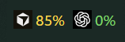
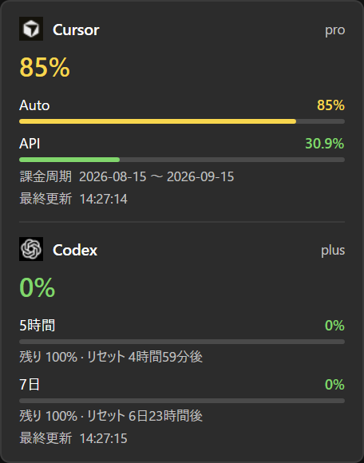

# AI Usage Bar

[](https://github.com/ham0806/ai-usage-bar/actions/workflows/ci.yml)
[](https://github.com/ham0806/ai-usage-bar/releases)
[](LICENSE)

English | [日本語](README.ja.md)

Shows usage for Cursor, Codex, Claude, OpenCode Go, and Command Code on the Windows 11 taskbar, just left of the notification area. Pick which providers to show in Settings.



The bar shows icons and percentages, or the balance for providers like OpenCode Go and Command Code. Left-click opens details such as breakdown, reset time, and billing cycle. Right-click has Refresh, Settings, and Exit.



## Install

Download `AI-Usage-Bar.exe` from [Releases](https://github.com/ham0806/ai-usage-bar/releases) and run it.

The UI follows the Windows display language (English, Japanese, Simplified Chinese, Spanish, Brazilian Portuguese, or German). Override it in Settings if needed.

## Requirements

- Windows 11
- .NET 8 SDK for development (`mise install dotnet@8`)
- For Codex: a working `codex login`
- For Cursor: a signed-in Cursor app, or the session token described below
- For Claude: a signed-in Claude Code (`~/.claude/.credentials.json`)
- For OpenCode Go and Command Code: their sign-in, or an API key pasted in Settings

## Run from source

```powershell
.\run.ps1
```

To see logs, or if the exe is not built yet:

```powershell
dotnet run --project src\AiUsageBar\AiUsageBar.csproj
```

A second launch exits instead of opening another instance. Exit from the widget's right-click menu.

To start with Windows, open Settings from the right-click menu and turn on **Start with Windows**.

## Build the exe

On a PC without .NET, you can still run the exe produced by `build.ps1`.

```powershell
.\build.ps1
```

Output: `dist\AI Usage Bar\AI Usage Bar.exe`. If you started from the exe, **Start with Windows** registers that exe.

Releases are published when a `vX.Y.Z` tag is pushed. GitHub Actions builds the exe and attaches it to the GitHub Release.

## Cursor auth

The app first reads `cursorAuth/accessToken` from `%APPDATA%\Cursor\User\globalStorage\state.vscdb`. If that is missing or returns 401, it uses the token pasted in Settings. Tokens are stored in Windows Credential Manager.

Paste the `WorkosCursorSessionToken` cookie from cursor.com. In Chrome: DevTools → Application → Cookies → `https://cursor.com`.

Cursor usage comes from the unofficial dashboard endpoint `GET https://cursor.com/api/usage-summary`, not an official API. It can break after product changes or when the session expires.

## Codex auth

Uses ChatGPT OAuth from `%USERPROFILE%\.codex\auth.json` (or `CODEX_HOME`). Near expiry it refreshes with the same JSON as the official CLI and writes back to `auth.json`. Endpoints: `https://chatgpt.com/backend-api/codex/usage` and `https://chatgpt.com/backend-api/wham/usage`. If those fail, it calls `account/rateLimits/read` on the installed `codex app-server` over JSON-RPC. Settings also has **Open codex login**. Tokens are not written to the log.

## Claude auth

Uses `claudeAiOauth` from `%USERPROFILE%\.claude\.credentials.json` (or `CLAUDE_CONFIG_DIR`) and reads the 5-hour, 7-day, and Opus windows from `GET https://api.anthropic.com/api/oauth/usage`. Near expiry it refreshes with the same client ID as Claude Code and writes the token and `expiresAt` back. If you sign in elsewhere, paste the OAuth token in Settings (stored in Windows Credential Manager).

## OpenCode Go auth

Usage comes from the console API (`GET https://opencode.ai/console/api/usage/summary`). That API only accepts a console session, so the `opencode-go` API key from `~/.local/share/opencode/auth.json` returns 403.

**Sign in to opencode** in Settings runs the same device flow as the CLI (`/console/auth/device/code`) and stores the console session in Windows Credential Manager. If that fails, paste the console session cookie instead (DevTools → Network → `usage/summary` → Request Headers → `Cookie`).

The numbers mirror the console's Limits panel. `GET /console/api/go/status` gives `access.meters` (`fiveHour` / `week` / `month`). The bar shows the 5-hour (Rolling) usage, and the flyout lists Rolling / Weekly / Monthly usage and reset times. Usage percentages are rounded up to whole numbers. Requests, tokens, cost, and daily history are not shown; the legacy usage summary is fetched only when the Go limits endpoint is unavailable.

These endpoints are scoped to the workspace you selected in the console and need `x-org-id`. The app takes the workspace from the device sign-in (`org_id`), the token, or `GET /console/api/user/workspaces`. With several workspaces, paste the Go page URL (`https://opencode.ai/console/wrk_…/go`) or the workspace ID in Settings → Workspace.

## Command Code auth

Uses the token from `%USERPROFILE%\.commandcode\auth.json` (or `COMMANDCODE_HOME`), `COMMAND_CODE_API_KEY`, or the API key pasted in Settings, in that order. `GET https://api.commandcode.ai/alpha/billing/credits` gives the 5-hour and weekly limits plus the credit balance, and `/alpha/billing/subscriptions` gives the plan name. The bar shows the credit balance, and the flyout adds the 5-hour and weekly usage. Without a sign-in, run `commandcode login` or paste an API key.

## Settings

`%LOCALAPPDATA%\ai-usage-bar\config.json` stores the refresh interval, which providers to show (`show_providers`), their order, position offset, language, `opencode_usage_url`, and `opencode_workspace_id`. It does not store secrets; tokens live in Windows Credential Manager. Logs: `%TEMP%\ai-usage-bar.log`.

If the bar overlaps the notification area, move it with Offset X / Y in Settings.

## Icons

Official logos are not bundled. Place your own PNGs with these names. Without them, only numbers are shown. Files added while running are picked up on the next draw (refresh or hover).

`%LOCALAPPDATA%\ai-usage-bar\icons\`

- `cursor-dark.png` / `cursor-light.png`
- `codex-dark.png` / `codex-light.png`
- `claude-dark.png` / `claude-light.png`
- `opencode-dark.png` / `opencode-light.png`
- `commandcode-dark.png` / `commandcode-light.png`

About 64px square is enough. Use `-dark` on a dark taskbar and `-light` on a light one. Do not commit these files.

## Architecture

Two projects, both `net8.0-windows`:

```text
src/AiUsageBar          WPF shell: taskbar widget, flyout, settings window, icon loading
src/AiUsageBar.Core     UI-free core: providers, auth, polling, layout math, Win32 interop
tests/AiUsageBar.Tests  xUnit tests, all against the core (no WPF)
```

`AiUsageBar.Core` has no WPF reference, so everything in it is testable without opening a window.

- A provider under `Providers/` is a static class that resolves its own credential through `Auth/`, maps the API response into `Models.cs`, and raises `ProviderErrors` on failure. `ProviderRegistry.All` is the single list the settings window renders from, so adding a provider means adding one entry there.
- `Poller` owns the refresh loop and the per-provider backoff. `WidgetLayout` computes bar geometry as pure functions, which is why the payload, layout and localization tests run headless.
- The overlay is Win32 (`Win32/Taskbar.cs`): locate the notification area, then host a child HWND beside it. `Win32/Fullscreen.cs` hides the bar while a fullscreen window is in the foreground.

Spacing, typography and color rules live in [DESIGN.md](DESIGN.md).

## Tests

`ci` runs `dotnet test` on every push to `master` and on pull requests.

```powershell
.\test.ps1
# or
dotnet test AiUsageBar.sln -c Release
```

Optional pre-push hook that runs the same suite before each push:

```powershell
git config core.hooksPath .githooks
```

## Limits

Overlaying the taskbar is not a documented Windows API. Position can drift after a major Windows update. Browser cookies are not extracted automatically because of Chrome App-Bound Encryption.

## License

[MIT](LICENSE) © 2026 ham0806
